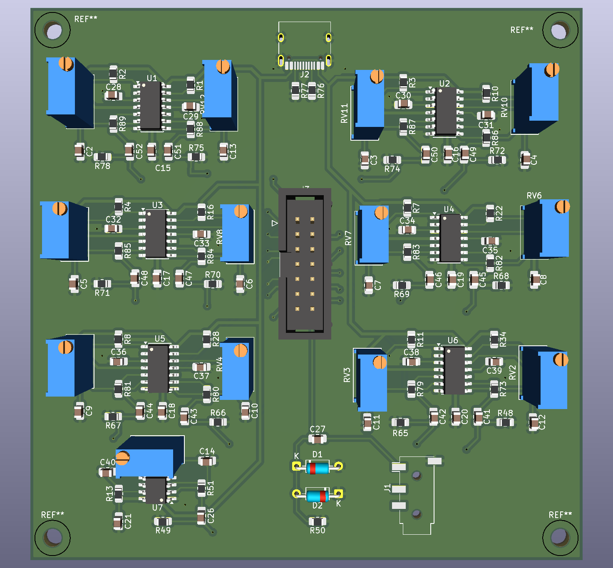
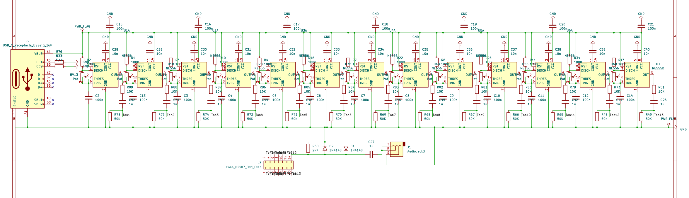
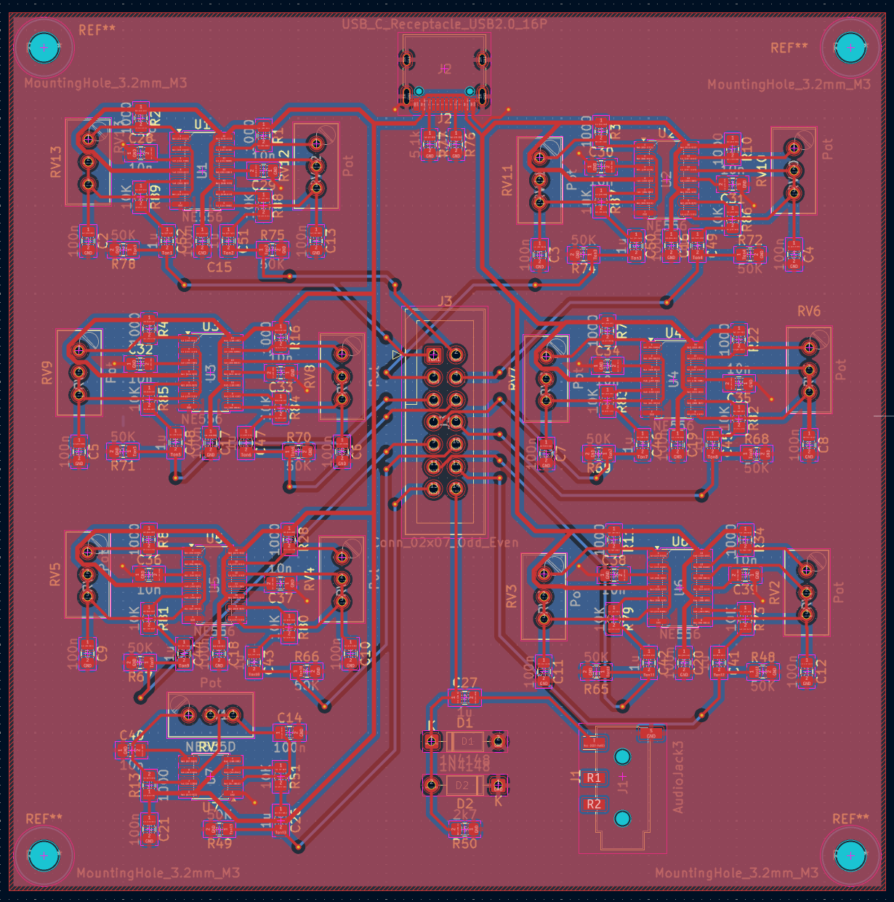
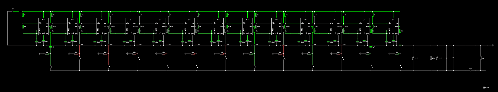

# 1-Octave Analog Synthesizer (NE556 / NE555)

An autonomous analog audio synthesizer designed to reproduce the fundamental frequencies of a full musical octave. Built using NE556 dual timer ICs and an NE555 timer, this project features integrated analog signal conditioning, hardware circuit protection, and a compact custom 2-layer PCB designed in KiCad.

  

## Project Overview & Engineering Highlights

- **Multi-Oscillator Tone Generation:** Designed dedicated astable multivibrator stages for each musical note in an octave using multiple NE556 timer ICs (and an NE555), allowing polyphonic and independent frequency tuning.
- **Signal Conditioning & AC Coupling:** 
  - Standard 555 output stages produce high-amplitude unipolar square waves (0–$V_{cc}$).
  - Integrated series AC coupling capacitors to eliminate DC bias.
  - Implemented resistive attenuation dividers to scale the output down to standard line-level audio.
- **Hardware Clamping & Overvoltage Protection:** Added antiparallel diode limiters across the output path to shunt transient voltage spikes directly to ground, protecting connected external audio interfaces / PC sound cards.
- **Tolerance Calibration:** Compensated for real-world passive component tolerances (*Bauteiltoleranzen*) by pairing fixed precision resistors with manual trimming potentiometers for calibration.
- **PCB Layout & Constraints:**
  - Designed within standard $100 \times 100\text{ mm}$ manufacturing boundaries.
  - Employed predominantly SMD passive components to achieve high component density and clean trace routing.
  - Routed dedicated headers for external key contacts and multi-purpose audio output jacks (line-out / speaker).

## Hardware Specifications

| Parameter | Specification |
| :--- | :--- |
| **Oscillators** | NE556 Dual Timers + NE555 (Astable Configuration) |
| **Target Bandwidth** | 1 Musical Octave (Equal Temperament frequencies) |
| **Output Protection** | Antiparallel Diode Clipping to GND + Series AC Blocking |
| **PCB Dimensions** | $100 \text{ mm} \times 100 \text{ mm}$ (2-layer FR4) |
| **Component Package** | Mixed SMD (passives/ICs) & THT (headers/trimming pots) |
| **EDA Tool** | KiCad 10.0 |

## Circuit & Layout Gallery

<table>
  <tr>
    <td align="center" width="50%">
      
       
      <b>Schematic Overview (<a href="hardware/outputs/schematic.pdf">Download PDF</a>)</b>
    </td>
    <td align="center" width="50%">
      
       
      <b>2-Layer PCB Trace Layout</b>
    </td>
  </tr>
</table>

## Simulation & Verification

The oscillator stages, passive AC coupling, and diode clamping network were verified through circuit simulation prior to schematic capture and layout.

  

- **Interactive Simulation:** [Run 1-Octave Synthesizer in Falstad](https://www.falstad.com/s.py?s=KYIuwd)
- **Circuit Data:** Raw netlist available at [`simulation/falstad_circuit.txt`](simulation/falstad_circuit.txt)
